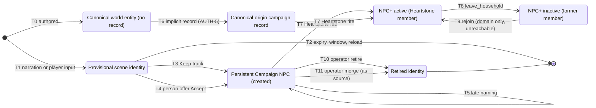
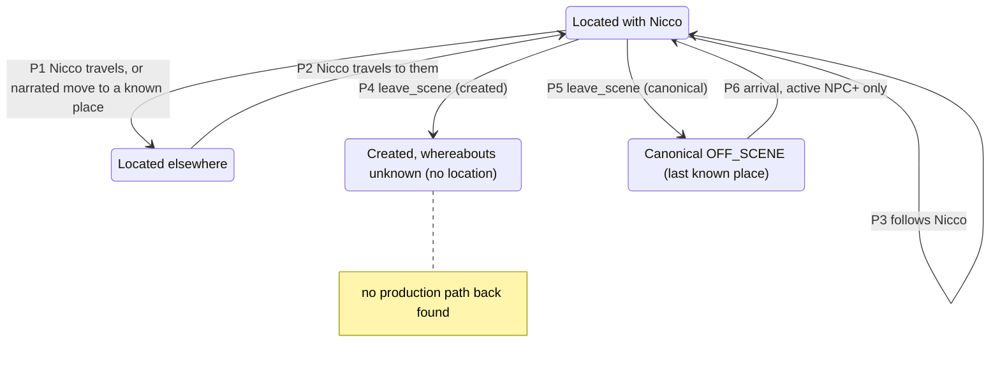

# NPC and Household Lifecycle Review

Status: Planning review (P7), read-only. Written 2026-10-13 against main `7e5e4ea` plus the uncommitted documentation reconciliation of the post-cleanup audit. Nothing was implemented and no test was run. Every claim about behavior cites the current code (`file:line`); claims marked **inferred** come from static reading only and were not confirmed by execution.

Sources, in order of authority: `src/` code, then `tests/`, then authored data, then [ARCHITECTURE.md](../ARCHITECTURE.md), [HEARTSTONE.md](../HEARTSTONE.md), the [Master Debt Register](../MASTER_DEBT_REGISTER.md) (section 7, section 6, "Current residual debt", section 16) and the [A9 register reconciliation](post_cleanup_audit/A9_REGISTER_RECONCILIATION.md).

Vocabulary used here (as in the repository): PROVISIONAL to PERSISTENT is **materialization** (`buildMaterializedCharacter`). Campaign NPC to NPC+ is **promotion** (the Heartstone rite), and only that. "Premium" in code is the legacy name of NPC+ (NAME-1).

## 1. Summary

1. The identity lifecycle (PROVISIONAL, PERSISTENT, RETIRED) and the NPC tier (canon, Campaign NPC, NPC+) are two separate axes in code, and both are explicit and player- or operator-authorized on the way *in*. On the way *out* the picture is incomplete: an NPC+ can be deactivated, but never reactivated, demoted, retired or merged away.
2. **The combination of NPC-4 and NPC-1 is more serious than either row alone.** A narrated, evidence-verified "I am leaving this household" voiced by an NPC+ commits `leave_household` with no player confirmation ([command-authorizer.ts:89-99](../../src/turn/authorization/command-authorizer.ts)), which turns every NPC+ behavior off ([premium-characters.ts:198-203](../../src/campaign/premium-characters.ts)). No production path brings that person back ([heartstone-rite.ts:39](../../src/campaign/heartstone-rite.ts)). In effect a narration-driven change is irreversible, which sits badly with the Class C principle in [ARCHITECTURE.md](../ARCHITECTURE.md) section 2c. Both rows are P3 and P2 today; the user may want to look at them together.
3. **An NPC+ is permanently an NPC+.** The premium record is never deleted ([premium-characters.ts:39-46](../../src/campaign/premium-characters.ts)), retirement refuses it with "resolve its NPC+ state first" ([character-repair.ts:39](../../src/campaign/character-repair.ts)), merge refuses it as a source ([character-repair.ts:72](../../src/campaign/character-repair.ts)), and no operation exists that "resolves NPC+ state". The refusal message points to an operation that does not exist.
4. **AUTH-5 / ID-8 still decides D5 implicitly.** `characterForUpdate` creates a canonical-origin campaign record on `set_profile`, `set_condition`, `set_slot_knowledge` and equipped `place_item` ([preparation.ts:11-20](../../src/campaign/preparation.ts)). Such a record makes the canonical NPC a `campaign_npc` tier ([character-capabilities.ts:39](../../src/app/character-capabilities.ts)) and rite-eligible, so the Promote control can appear for it ([player-character-view.ts:233-234](../../src/app/player-character-view.ts), [heartstone-rite.ts:37-38](../../src/campaign/heartstone-rite.ts)). **Inferred**, not reproduced.
5. **Two "return" transitions have no production path (inferred).** A created persistent character whose location was cleared by `leave_scene` ([characters.ts:84](../../src/campaign/characters.ts)) is outside every movement scope ([character-movement.ts:39](../../src/turn/movement/character-movement.ts)), and a canonical NPC that is OFF_SCENE and not an active NPC+ cannot be moved by narration at all ([command-authorizer.ts:68](../../src/turn/authorization/command-authorizer.ts)). The narration audit then keeps both out of the prose ([narration-audit.ts:288-307](../../src/turn/audit/narration-audit.ts)). This is not a register row today.
6. **"Household member who is not NPC+" cannot exist in production.** Only one household is created (Heartstone, [opening-state.ts:28-29](../../src/campaign/opening-state.ts)); every current member of a household Nicco keeps must have a premium record ([snapshot-validation.ts:199](../../src/campaign/snapshot-validation.ts)). The generic voluntary `join_household` path has no target household in production; only `leave_household` is live.
7. Documentation drift: [ARCHITECTURE.md](../ARCHITECTURE.md) (character lifecycle table and the rule paragraph after it) presents the implicit canonical record as designed behavior ("materialized lazily by the engine") and lists it as a `register_character` producer, while the register treats it as open debt waiting on D5, and the code pushes the record directly without `register_character`. Details in section 7.

## 2. Lifecycle states and who owns them today

| State | Authoritative store | Owning module (writes) | Entry point(s) | Notes |
| --- | --- | --- | --- | --- |
| Canonical world entity | `WorldStore` (authored, read-only); runtime location in `snapshot.runtime.npc_locations` | [world/runtime-domain.ts](../../src/world/runtime-domain.ts) for location; campaign domains (legal, relationships, knowledge) may key on the canonical id with no record ([identity.ts:14-20](../../src/campaign/identity.ts)) | none (authored) | Canon-placed; moved by narration only while an active NPC+ ([command-authorizer.ts:66-68](../../src/turn/authorization/command-authorizer.ts)) |
| Canonical-origin campaign record | `snapshot.characters[]`, `origin.kind = "canonical"` | [preparation.ts:11-20](../../src/campaign/preparation.ts) (implicit), [characters.ts:15-31](../../src/campaign/characters.ts) (`register_character`, no production emitter) | none deliberate | AUTH-5 / ID-8 / D5 |
| Provisional scene identity | not stored; derived from the scene reading plus the session's `SceneParticipants` | [narration-facts/scene-identity.ts](../../src/turn/narration-facts/scene-identity.ts), [scene-participants.ts](../../src/turn/identity/scene-participants.ts) (session-local, [turn-coordinator.ts:83](../../src/turn/coordinator/turn-coordinator.ts)) | narration; player input | Never saved; unkept participants lost on reload (PER-2B) |
| Persistent Campaign NPC (created) | `snapshot.characters[]`, `origin.kind = "created"`, `origin_snapshot` | [materialization.ts:35-46](../../src/campaign/materialization.ts) via [provisional-people.ts:73-78](../../src/turn/identity/provisional-people.ts) | `GameSession.keepTrack`, `GameSession.acceptTradeOffer` | Late naming by `set_profile` ([name-establishment.ts:49-58](../../src/turn/identity/name-establishment.ts)) |
| NPC+ (active) | `snapshot.premium_characters[]` with `metadata.active_household_member = true`, derived from `households[].members` | [premium-characters.ts:182-214](../../src/campaign/premium-characters.ts) (`syncPremiumCharacters`, run in every preparation, [campaign-state.ts:74](../../src/campaign/campaign-state.ts)) | `GameSession.completeHeartstoneRite` | Membership is the authority; the premium record is derived but permanent |
| Household member | `snapshot.households[].members[]` | [social.ts:56-71](../../src/campaign/social.ts) | the rite (join); narration evidence (leave) | In production a member of the Heartstone household is always an active NPC+ |
| Non-household persistent NPC | `snapshot.characters[]` with no active membership (including `former_member` rows) | as above | as above | Includes inactive NPC+ |
| NPC+ (inactive) | premium record with `active_household_member = false`; membership `former_member` | [premium-characters.ts:198-203](../../src/campaign/premium-characters.ts) | `leave_household` | Tier, badge and editor stay; behavior off |
| Retired identity | the same `characters[]` record with `retirement`, `status = inactive`, no location | [character-repair.ts:123-168](../../src/campaign/character-repair.ts) | `GameSession.requestRepair` then `confirmPending` | Terminal by design; created, non-NPC+ only |
| Pending repair request | PendingConfirmation log (interaction metadata, saved with the campaign, not `CampaignState`) | [game-session.ts:514-539](../../src/app/game-session.ts), [confirmation-kinds.ts:68-92](../../src/app/confirmation-kinds.ts) | `/api/repair/request` (no player UI) | Operator only |

Note on the starting points named in the brief: `src/campaign/households.ts` does not exist (household commands live in [social.ts:56-71](../../src/campaign/social.ts)), and the PROVISIONAL / PERSISTENT / RETIRED lifecycle is defined in [character-lifecycle.ts:1-24](../../src/campaign/character-lifecycle.ts), not in `campaign-state.ts`.

## 3. Transitions that exist today

### 3.1 Identity and tier

| # | Transition | Trigger and authority | Evidence |
| --- | --- | --- | --- |
| T0 | Canonical entity exists | Authored world data; runtime placement in `npc_locations` | [identity.ts:14-20](../../src/campaign/identity.ts) (`refs.character` accepts a canonical id with no record) |
| T1 | Provisional person appears | (a) Narration introduces or names a person: reported as `ProvisionalPerson`, no command ([name-establishment.ts:59-76](../../src/turn/identity/name-establishment.ts)). (b) Player input with an interaction verb and a role phrase creates `scene_npc_<n>` ([scene-participants.ts:165-179](../../src/turn/identity/scene-participants.ts)). A narrated name only renames the participant ([scene-participants.ts:214-217](../../src/turn/identity/scene-participants.ts)) | [provisional-people.ts:6-21](../../src/turn/identity/provisional-people.ts) |
| T2 | Provisional person forgotten | Scene change, narrated departure plus one unaddressed turn, two inactive turns, or capacity eviction ([scene-participants.ts:152](../../src/turn/identity/scene-participants.ts), [:190-201](../../src/turn/identity/scene-participants.ts)); recent-exchange window moves on; reload drops participants (PER-2B) | [provisional-people.ts:18-20](../../src/turn/identity/provisional-people.ts) |
| T3 | Keep track | Player's explicit action, opaque token plus `expected_revision`; one `register_character` built by `materializeProvisional({ identity_only, trigger: "player_kept" })`; idempotent per token; fail-closed blocks `offer_subject`, `ambiguous_name`, `canonical_name`, `same_name_persistent`; the participant leaves the registry | [game-session.ts:599-620](../../src/app/game-session.ts), [keep-track.ts:51-53](../../src/turn/identity/keep-track.ts), [:108-111](../../src/turn/identity/keep-track.ts), [:121-128](../../src/turn/identity/keep-track.ts) |
| T4 | Person offer Accept | Player's Accept settles the stored plan in one revision; the plan materializes the captive subject and, when the seller is a named narrated person, the seller too; the origin snapshot is restamped at the commit revision | [game-session.ts:560-585](../../src/app/game-session.ts), [person-offers.ts:331-341](../../src/turn/commerce/person-offers.ts), [:348-351](../../src/turn/commerce/person-offers.ts), [trade.ts:214-219](../../src/campaign/trade.ts) |
| T5 | Late naming (same record) | A present, unnamed persistent character's own self-introduction; reserved canonical handles refused | [name-establishment.ts:49-58](../../src/turn/identity/name-establishment.ts) |
| T6 | Implicit canonical record | Any of `set_profile`, `set_condition`, `set_slot_knowledge`, equipped `place_item` on a canonical id with no record pushes `{ id, origin, profile: {}, current: {} }` | [preparation.ts:11-20](../../src/campaign/preparation.ts); callers [characters.ts:47](../../src/campaign/characters.ts), [:51](../../src/campaign/characters.ts), [:88](../../src/campaign/characters.ts), [items.ts:19](../../src/campaign/items.ts), [:23](../../src/campaign/items.ts) |
| T7 | Promotion (Heartstone rite) | Player's Promote action, opaque ref plus revision; eligibility: a campaign record, not Nicco, not already NPC+, Heartstone household exists with Nicco as owner-member, active, inside the Heartstone interior; one `join_household`; `syncPremiumCharacters` creates the premium record and an initial mannerism in the same preparation | [game-session.ts:404-422](../../src/app/game-session.ts), [heartstone-rite.ts:35-53](../../src/campaign/heartstone-rite.ts), [social.ts:57-64](../../src/campaign/social.ts), [premium-characters.ts:186-192](../../src/campaign/premium-characters.ts) |
| T8 | NPC+ leaves the household | Controller `leave_household` authorized by narration evidence (a voiced choice by the present member, not the owner); premium record deactivated with a `left_household` development | [command-authorizer.ts:89-99](../../src/turn/authorization/command-authorizer.ts), [evidence-authorization.ts:291-295](../../src/turn/authorization/evidence-authorization.ts), [:425](../../src/turn/authorization/evidence-authorization.ts), [social.ts:65-71](../../src/campaign/social.ts), [premium-characters.ts:198-203](../../src/campaign/premium-characters.ts) |
| T9 | Rejoin | Supported by the domain only (the same record reactivates, `rejoined_household`); no production producer, see section 4.2 | [premium-characters.ts:193-196](../../src/campaign/premium-characters.ts); test `tests/npc-plus/npc-plus-foundation.test.ts:44-56` |
| T10 | Operator retire | `requestRepair({operation: "retire"})` creates a PendingConfirmation after a conflict-free preflight; Confirm commits `retire_character`; refused for the player, canonical records, NPC+, household members, legal holds and holders, items, funds, active offers | [game-session.ts:514-539](../../src/app/game-session.ts), [:473-496](../../src/app/game-session.ts), [confirmation-kinds.ts:68-78](../../src/app/confirmation-kinds.ts), [characters.ts:33-39](../../src/campaign/characters.ts), [character-repair.ts:36-48](../../src/campaign/character-repair.ts), [:123-126](../../src/campaign/character-repair.ts) |
| T11 | Operator merge | Same flow; the source is retired with `merged_into`; refused when the source is NPC+ or canonical; the target may be a canonical id with no record | [confirmation-kinds.ts:80-92](../../src/app/confirmation-kinds.ts), [characters.ts:40-45](../../src/campaign/characters.ts), [character-repair.ts:23-31](../../src/campaign/character-repair.ts), [:53-120](../../src/campaign/character-repair.ts), [:128-168](../../src/campaign/character-repair.ts) |

Not drawn because it cannot occur in production: a household member who is not NPC+ (see summary point 6). Narration and the Controller can never trigger T3, T4, T7, T10 or T11: the Controller schema has no `register_character`, `retire_character`, `merge_characters` or premium kind ([controller-schema.ts:35-36](../../src/llm/controller-schema.ts) lists only `join_household` / `leave_household` among identity-adjacent kinds), and a join into the household Nicco keeps is refused ([command-authorizer.ts:98](../../src/turn/authorization/command-authorizer.ts)); pinned by `tests/authority/explicit-character-materialization.test.ts:110` and `:139-152`.

### 3.2 Presence (where a person is)

Presence is not part of the identity lifecycle, but most of the "absent" and "return" questions are presence questions.

| # | Transition | Evidence |
| --- | --- | --- |
| P1 | A created character's narrated completed movement within the scenes Nicco is in or leaves; canonical NPCs only while active NPC+ | [command-authorizer.ts:62-72](../../src/turn/authorization/command-authorizer.ts), [characters.ts:57-67](../../src/campaign/characters.ts), [character-movement.ts:38-48](../../src/turn/movement/character-movement.ts) |
| P2 | Player travel changes only Nicco's location | [player-travel.ts:72](../../src/turn/movement/player-travel.ts) |
| P3 | Follow candidates: active NPC+, a created person Nicco holds, a created household member, a created person invited by name | [follow-candidates.ts:24-44](../../src/turn/movement/follow-candidates.ts), [character-movement.ts:175-186](../../src/turn/movement/character-movement.ts) |
| P4 | `leave_scene` deletes a created character's location | [characters.ts:82-85](../../src/campaign/characters.ts) |
| P5 | `leave_scene` makes a canonical NPC OFF_SCENE | [characters.ts:72-81](../../src/campaign/characters.ts), [runtime-domain.ts:29-32](../../src/world/runtime-domain.ts) |
| P6 | An active canonical NPC+ elsewhere or off-scene may be narrated arriving by name | [character-movement.ts:63-70](../../src/turn/movement/character-movement.ts), [movement-scope.ts:24](../../src/turn/movement/movement-scope.ts) |

## 4. What currently happens, case by case

### 4.1 An NPC+ leaves the household

- **Trigger.** Only narration evidence: the member, present, voices leaving; the Controller proposes `leave_household`; the grammar (`household_choices`) or verified hybrid evidence authorizes it ([command-authorizer.ts:89-99](../../src/turn/authorization/command-authorizer.ts), [evidence-authorization.ts:291-295](../../src/turn/authorization/evidence-authorization.ts)). The Controller prompt allows it ([state-controller.ts:23](../../src/llm/openrouter/state-controller.ts)). There is no player confirmation and no UI action (NPC-4).
- **Commit.** The membership becomes `former_member` ([social.ts:65-71](../../src/campaign/social.ts)); in the same preparation the premium record is set inactive and records `left_household` ([premium-characters.ts:198-203](../../src/campaign/premium-characters.ts)); snapshot validation requires `active_household_member` to equal membership ([snapshot-validation.ts:173](../../src/campaign/snapshot-validation.ts)).
- **What stays.** The premium record, contracts, developments and mannerisms; tier `npc_plus` and the "NPC+" badge ([character-capabilities.ts:39](../../src/app/character-capabilities.ts), [client.js:531](../../src/ui/client.js), [:610](../../src/ui/client.js)); the appearance editor and portrait management, because editing follows promotion and not membership ([player-character-view.ts:184-186](../../src/app/player-character-view.ts); test U17, `tests/ui/play-client.test.ts:828-834`). Legal status is untouched (an enslaved NPC+ who leaves stays held).
- **What stops.** Every behavior gated by `activeNpcPlus` or `active_household_member`: 17 sites in 11 files (NPC+ prompt context [npc-plus.ts:149](../../src/turn/context/npc-plus.ts), scene-state projection [scene-state-projection.ts:164](../../src/turn/context/scene-state-projection.ts), movement and follow [follow-candidates.ts:25](../../src/turn/movement/follow-candidates.ts), [character-movement.ts:46](../../src/turn/movement/character-movement.ts), [:64](../../src/turn/movement/character-movement.ts), [stages/authorization.ts:73](../../src/turn/stages/authorization.ts), [:97](../../src/turn/stages/authorization.ts), [command-authorizer.ts:67](../../src/turn/authorization/command-authorizer.ts), [:78](../../src/turn/authorization/command-authorizer.ts), contracts [character-contracts.ts:31](../../src/turn/authorization/character-contracts.ts), [premium-characters.ts:84](../../src/campaign/premium-characters.ts), reflection [reflection.ts:38](../../src/turn/optional/reflection.ts), [premium-characters.ts:74](../../src/campaign/premium-characters.ts), mannerisms [mannerism-extraction.ts:107](../../src/turn/optional/mannerism-extraction.ts), [mannerism-learning.ts:55](../../src/campaign/mannerism-learning.ts), [:75](../../src/campaign/mannerism-learning.ts), [:101](../../src/campaign/mannerism-learning.ts)). Heartstone recognition follows membership ([heartstone-recognition.ts:16-19](../../src/campaign/heartstone-recognition.ts)). The person disappears from the Household panel, which lists only current members ([session-view.ts:100-110](../../src/app/session-view.ts)). `SessionView.promoted` carries a `household_member` flag ([session-view.ts:121](../../src/app/session-view.ts)) but the client does not render it, so there is no "inactive NPC+" badge.
- **A canonical NPC+ who leaves** reverts to canon placement: `move_character` for a canonical NPC requires an *active* NPC+ ([command-authorizer.ts:66-68](../../src/turn/authorization/command-authorizer.ts)).

### 4.2 An NPC returns

- **To the household (rejoin).** Refused. The Promote card is not computed for anyone with a premium record ([player-character-view.ts:234](../../src/app/player-character-view.ts)); `completeHeartstoneRite` would refuse anyway with `already_npc_plus` ([heartstone-rite.ts:39](../../src/campaign/heartstone-rite.ts)); a narrated or Controller join into Nicco's household is refused ([command-authorizer.ts:98](../../src/turn/authorization/command-authorizer.ts)). The domain would reactivate the same record ([premium-characters.ts:193-196](../../src/campaign/premium-characters.ts)). The current refusal is pinned by `tests/npc-plus/explicit-promotion.test.ts:234-244`; the domain rejoin by `tests/npc-plus/npc-plus-foundation.test.ts:44-56`.
- **To the scene.** A created person with a known location returns when Nicco goes there (P2) or follows him (P3). A created person whose location was cleared (P4) is outside every movement scope ([character-movement.ts:39](../../src/turn/movement/character-movement.ts) requires `current_location`), and the audit refuses prose in which they act ([narration-audit.ts:299-307](../../src/turn/audit/narration-audit.ts)); no production path back was found (**inferred**). A canonical OFF_SCENE NPC returns only as an active NPC+ entrant (P6); otherwise no path was found (**inferred**; NPC routines are a later roadmap item in [MASTER_ROADMAP.md](../MASTER_ROADMAP.md)).
- **In narration, after an absence.** A named persistent person present in the scene is recognized by name (`campaign_names`, [name-establishment.ts:40](../../src/turn/identity/name-establishment.ts)). A name that matches a held or household person who is elsewhere is skipped as `persistent_identity_elsewhere` ([name-establishment.ts:66-69](../../src/turn/identity/name-establishment.ts)); any other same-named persistent person elsewhere is not linked (F2, by the "names are not identity" rule) but Keep track refuses the name anywhere (`same_name_persistent`, [keep-track.ts:97](../../src/turn/identity/keep-track.ts), [:111](../../src/turn/identity/keep-track.ts)). An unnamed persistent person elsewhere is never linked to a re-narrated look-alike (ID-1 residual); the fork scanner is offline only ([dev/maintenance/scan-identity-forks.ts](../../src/dev/maintenance/scan-identity-forks.ts)). A provisional person who returns after the window moved on is a new reading; a named one gets the same `narrated:<name>` ref ([provisional-people.ts:9-11](../../src/turn/identity/provisional-people.ts)).

### 4.3 A canonical person becomes persistent

- A canonical NPC is already a durable world identity: runtime location, and legal status, relationships and knowledge keyed by its canonical id, all without a campaign record ([identity.ts:14-20](../../src/campaign/identity.ts)).
- **No deliberate producer** of a canonical-origin campaign record exists. `register_character` with a canonical origin is accepted by validation ([identity.ts:38-43](../../src/campaign/identity.ts), [characters.ts:15-31](../../src/campaign/characters.ts)), but its production emitters build created characters only ([keep-track.ts:121-128](../../src/turn/identity/keep-track.ts), [person-offers.ts:331-350](../../src/turn/commerce/person-offers.ts)). Canonical records appear in tests only (for example `tests/npc-plus/explicit-promotion.test.ts:44`).
- **Implicit producer (AUTH-5).** `characterForUpdate` ([preparation.ts:11-20](../../src/campaign/preparation.ts)). The most plausible production trigger is a Controller `set_condition` with a physical condition on a present canonical NPC, authorized by verified evidence ([command-authorizer.ts:53-60](../../src/turn/authorization/command-authorizer.ts), [evidence-authorization.ts:425](../../src/turn/authorization/evidence-authorization.ts)). **Inferred**, not reproduced. The record has no `origin_snapshot` and is not built by the materialization builder, so it is not "materialization" in the repository's own vocabulary.
- **Consequences of the implicit record.** The tier changes from `world_canon` to `campaign_npc` ([character-capabilities.ts:39](../../src/app/character-capabilities.ts)); rite eligibility is computed and, inside Heartstone, the Promote control becomes available ([player-character-view.ts:233-234](../../src/app/player-character-view.ts), [heartstone-rite.ts:37-38](../../src/campaign/heartstone-rite.ts)). Promotion of such a record works and keeps the same identity (`tests/npc-plus/explicit-promotion.test.ts:165-173`). Keep track never lists canonical people ([keep-track.ts:81](../../src/turn/identity/keep-track.ts)). Retirement refuses canonical records ([character-repair.ts:29](../../src/campaign/character-repair.ts)), so the implicit record cannot be undone.

### 4.4 A persistent Campaign NPC becomes NPC+

Only through T7. The rite is one `join_household` into the Heartstone household; NPC+ is derived in the same preparation (one revision or none) ([heartstone-rite.ts:50-53](../../src/campaign/heartstone-rite.ts), [campaign-state.ts:74](../../src/campaign/campaign-state.ts)). Eligibility reads no prose and checks no legal status, consent or relationship (NPC-5, [heartstone-rite.ts:35-47](../../src/campaign/heartstone-rite.ts)): a person Nicco holds as enslaved can be promoted. The commit swallows any exception into `campaign_validation_failed` with no log (NPC-6, [game-session.ts:421](../../src/app/game-session.ts)). A narrated or Controller join, however rite-like, is refused ([command-authorizer.ts:98](../../src/turn/authorization/command-authorizer.ts); `tests/npc-plus/explicit-promotion.test.ts:211`).

### 4.5 An NPC+ is demoted or removed

Not supported. The premium record is "the single authoritative promotion state", permanent from the rite ([premium-characters.ts:39-46](../../src/campaign/premium-characters.ts)); only `syncPremiumCharacters` writes `premium_characters`, and it only pushes or toggles ([premium-characters.ts:186-203](../../src/campaign/premium-characters.ts)). Retirement refuses an NPC+ ([character-repair.ts:39](../../src/campaign/character-repair.ts)) and merge refuses one as source ([character-repair.ts:72](../../src/campaign/character-repair.ts)); an NPC+ may be a merge *target*. No test covering these two refusals was found by searching `tests/` for `retireConflicts`, `mergeConflicts` and `requestRepair` with NPC+ cases. Leaving the household (4.1) is deactivation, not demotion. The roadmap records "decision on automatic demotion (currently none)" ([MASTER_ROADMAP.md](../MASTER_ROADMAP.md), T-NPC+); there is no register row for it.

### 4.6 A person is absent or off-screen

| Who | What happens | Evidence |
| --- | --- | --- |
| Provisional (participant or narrated) | Expires by the participant rules or the exchange window; nothing persists; unkept participants are lost on reload (PER-2B, accepted) | [scene-participants.ts:23-24](../../src/turn/identity/scene-participants.ts), [:190-194](../../src/turn/identity/scene-participants.ts), [provisional-people.ts:18-20](../../src/turn/identity/provisional-people.ts) |
| Persistent created | Keeps the last committed location, or none after `leave_scene`; may be remembered but never act in another scene ("never acts in the scene again until state brings it back") | [characters.ts:82-85](../../src/campaign/characters.ts), [narration-audit.ts:299-307](../../src/turn/audit/narration-audit.ts) |
| Canonical (not NPC+) | Canon-placed; OFF_SCENE after `leave_scene`; participation in a scene they are absent from is an audit issue | [characters.ts:72-81](../../src/campaign/characters.ts), [narration-audit.ts:288-298](../../src/turn/audit/narration-audit.ts) |
| Active NPC+ | Still in the NPC+ context as background (tier C) when absent; may be narrated arriving | [npc-plus.ts:9-20](../../src/turn/context/npc-plus.ts), [:147-160](../../src/turn/context/npc-plus.ts), [character-movement.ts:63-70](../../src/turn/movement/character-movement.ts) |
| Inactive NPC+ | Nothing in the NPC+ context; behaves like a Campaign NPC of its origin | section 4.1 |
| Retired | Excluded from presence, targeting and foreground binding | [character-lifecycle.ts:22-24](../../src/campaign/character-lifecycle.ts), [character-repair.ts:123-126](../../src/campaign/character-repair.ts) |

No time-based process moves anyone while they are off-screen (no routines; [agenda.ts](../../src/campaign/agenda.ts) does not touch `npc_locations`).

### 4.7 A campaign identity collides with canon

- **Ids** cannot collide: created ids carry the `campaign_character_` prefix and `newId` rejects any id the world or a campaign domain already holds ([identity.ts:33-37](../../src/campaign/identity.ts)).
- **Names.** Canonical names and aliases are reserved handles in three places: the provisional reading ([name-establishment.ts:64](../../src/turn/identity/name-establishment.ts)), late naming ([name-establishment.ts:54](../../src/turn/identity/name-establishment.ts)) and Keep track ([keep-track.ts:110](../../src/turn/identity/keep-track.ts)), all through [canonical-name-reservation.ts:16-18](../../src/turn/identity/canonical-name-reservation.ts). **The person offer plan does not apply it** (AUD-1, confirmed statically): the subject ([person-offers.ts:331-333](../../src/turn/commerce/person-offers.ts)) and a named seller ([person-offers.ts:348-350](../../src/turn/commerce/person-offers.ts)) are materialized with `p.name` and no `claimsReservedHandle` call (the only callers are the two files above).
- **Bound canonical partner.** A self-introduction under another name by the bound canonical partner creates nobody ([name-establishment.ts:62](../../src/turn/identity/name-establishment.ts), [partner-identity-guard.ts](../../src/turn/identity/partner-identity-guard.ts)).
- **Repair.** An operator merge may target a canonical id that has no campaign record ([character-repair.ts:27](../../src/campaign/character-repair.ts), [:29](../../src/campaign/character-repair.ts)); references are rewritten to the canonical id, the duplicate is retired, and no record is created for the target ([character-repair.ts:128-168](../../src/campaign/character-repair.ts)). This is reachable only through `POST /api/repair/request` ([server.ts:190-196](../../src/ui/server.ts)); the play client has no repair UI.
- **Canon changes between saves.** Load-time reconciliation only prunes runtime entries of NPCs no longer authored (AUTH-6, [canon-compatibility.ts:85-99](../../src/persistence/canon-compatibility.ts)). A created character whose name later becomes a canonical name or alias is not checked at load (**inferred** from the same file; names are not identity, so this is not an integrity failure).

## 5. Re-audit of the register rows

| Row | Register status | Verdict on current code | Current evidence | Notes |
| --- | --- | --- | --- | --- |
| NPC-1 | P2, needs D4 | CONFIRMED OPEN | [heartstone-rite.ts:39](../../src/campaign/heartstone-rite.ts), [player-character-view.ts:234](../../src/app/player-character-view.ts), [command-authorizer.ts:98](../../src/turn/authorization/command-authorizer.ts); domain rejoin [premium-characters.ts:193-196](../../src/campaign/premium-characters.ts) | Register line refs are still correct. The capability projection is a second gate the row does not name |
| NPC-2 | P2, D4 | CONFIRMED OPEN | `activeNpcPlus` [premium-characters.ts:35-37](../../src/campaign/premium-characters.ts); 17 gated sites in 11 files (4.1) | Register says "about 20 sites"; 17 found. Editor stays available (U17), as the row says |
| NPC-3 / ID-8 / F8 | P2, D5 | CONFIRMED OPEN, NEEDS DECISION | [preparation.ts:11-20](../../src/campaign/preparation.ts); no deliberate producer | The implicit path also turns on the Promote control (4.3), which the row does not state |
| NPC-4 | P3 | CONFIRMED OPEN | [command-authorizer.ts:89-99](../../src/turn/authorization/command-authorizer.ts), [evidence-authorization.ts:291-295](../../src/turn/authorization/evidence-authorization.ts) | With NPC-1 unresolved the narrated leave is irreversible (summary point 2). The severity may deserve a second look by the user |
| NPC-5 | P3, by design | CONFIRMED OPEN | [heartstone-rite.ts:35-47](../../src/campaign/heartstone-rite.ts) | Unchanged |
| NPC-6 | P3 | CONFIRMED OPEN | [game-session.ts:421](../../src/app/game-session.ts) | The register still cites `:356` (A9 already notes it). Keep track has the same silent catch ([game-session.ts:614-615](../../src/app/game-session.ts)) |
| NPC-7 | P3 | CONFIRMED OPEN | [premium-characters.ts:10-14](../../src/campaign/premium-characters.ts) | Beyond "household membership is the ONLY trigger", the comment also claims rejoin and "origin is irrelevant", which depend on NPC-1 and D5 |
| AUTH-5 | P2 | CONFIRMED OPEN | callers [characters.ts:47](../../src/campaign/characters.ts), [:51](../../src/campaign/characters.ts), [:88](../../src/campaign/characters.ts), [items.ts:19](../../src/campaign/items.ts), [:23](../../src/campaign/items.ts) | Caller list as corrected in 1A.4 is complete |
| AUTH-2 residual | P3, manual repair only | CONFIRMED OPEN | [game-session.ts:514-539](../../src/app/game-session.ts); no client UI (`src/ui/client.js` has no repair call) | Repair is operator-only by HTTP; NPC+ and canonical records are outside it |
| AUD-1 | P2, unconfirmed | CONFIRMED STATICALLY, not by execution | [person-offers.ts:331-333](../../src/turn/commerce/person-offers.ts), [:348-350](../../src/turn/commerce/person-offers.ts) | Register path `src/commerce/person-offers.ts` is stale; current path `src/turn/commerce/person-offers.ts` |
| F2 | P2, partial | CONFIRMED OPEN | [name-establishment.ts:66-69](../../src/turn/identity/name-establishment.ts) covers held and household people only | By design for others |
| F4 / I10 | P3 | CONFIRMED OPEN | [name-establishment.ts:24](../../src/turn/identity/name-establishment.ts), [:49-51](../../src/turn/identity/name-establishment.ts) | Late naming only for a present record |
| PER-2B | P3, accepted | CONFIRMED OPEN | [scene-participants.ts:134-145](../../src/turn/identity/scene-participants.ts), [turn-coordinator.ts:83](../../src/turn/coordinator/turn-coordinator.ts) | Accepted by the user |
| I1 / ID-4 | P2 | CONFIRMED OPEN | [keep-track.ts:51-53](../../src/turn/identity/keep-track.ts) checks only its own token | Related: `keptCharacter` ignores retired records, so a retired kept person's scene token is keepable again as a new identity (**inferred**) |
| I11 | obsolete per A9 (F3) | OK | seed [scene-participants.ts:128-132](../../src/turn/identity/scene-participants.ts) | ID-2 closed in block 12 |
| NAME-1 / VOC-1 | P3, D6 | CONFIRMED OPEN | `premium_*` keys; `established_at_promotion` [prompt-builder.ts:230](../../src/turn/context/prompt-builder.ts) | Schema-bound, unchanged |

## 6. Missing lifecycle transitions and state ownership

| # | Missing transition | Today | State it would change | Who would own it | Gate |
| --- | --- | --- | --- | --- | --- |
| M1 | Inactive NPC+ back to active (rejoin) | Refused in production; works in the domain | `households[].members` (authority); premium `active_household_member` (derived by sync) | `heartstone-rite.ts` eligibility, `GameSession.completeHeartstoneRite`, the capability projection in `player-character-view.ts` | D4, NPC-1 |
| M2 | Leaving Nicco's household with the player's authority | Narration evidence alone commits it | `households[].members` | `command-authorizer.ts` (refusal), optionally a confirmation kind in `confirmation-kinds.ts` | NPC-4; Class C principle |
| M3 | Behavior of an inactive NPC+ | All off | derived only (`activeNpcPlus`) | `premium-characters.ts:35-37` and its 17 consumers | D4, NPC-2 |
| M4 | NPC+ back to Campaign NPC (demotion), or removal of the premium record | Not possible | `premium_characters[]` | `premium-characters.ts` (sole writer today) | New question; roadmap "automatic demotion (currently none)"; no register row |
| M5 | NPC+ to retired, or NPC+ as merge source | Refused | `characters[].retirement`, premium record | `character-repair.ts:39`, `:72` | Depends on M4 |
| M6 | Canonical entity to canonical-origin record, deliberately | Implicit only (T6) | `characters[]` | `preparation.ts:11-20` today; a deliberate command would sit in `characters.ts` | D5, AUTH-5, ID-8 |
| M7 | Canonical NPC to NPC+, deliberately | Possible only after M6's implicit record | households, premium | `heartstone-rite.ts:37-38` | D5 |
| M8 | Created persistent person with no location back into a scene | No path found (**inferred**) | `characters[].current.current_location` | `characters.ts` `move_character`; movement scope in `character-movement.ts:38-48` | No register row |
| M9 | Canonical OFF_SCENE NPC (not active NPC+) back to a place | No path found (**inferred**) | `runtime.npc_locations` | `world/runtime-domain.ts`; NPC routines (later roadmap item) | No register row |
| M10 | Retired back to active | Refused by design | none | none | By design ([ARCHITECTURE.md](../ARCHITECTURE.md) RETIRED row) |
| M11 | Unkept unnamed participant kept across reload | Not saved | none (session-local) | `SceneParticipants` | PER-2B, accepted |
| M12 | Late naming of an absent unnamed persistent person | Not supported | `characters[].profile.name` | `name-establishment.ts` | F4 |
| M13 | Linking an absent persistent person to a re-narrated one | Offline scanner plus manual merge only | `characters[]` via merge | `identity-fork-scanner.ts` (dev), `GameSession.requestRepair` | F2, ID-1 residual, AUTH-2 residual |
| M14 | Death | No production producer of `status: "dead"` (only `applyRetirement` sets `inactive`, [character-repair.ts:125](../../src/campaign/character-repair.ts)); the authorizer refuses status changes ([command-authorizer.ts:59](../../src/turn/authorization/command-authorizer.ts)) | `characters[].current.status` | `characters.ts` `set_condition` | No register row; observation only |
| M15 | Joining a household Nicco does not keep | No such household is created in production | `households[]` | `social.ts` | Observation; relevant to Property |
| M16 | Reserved canonical handle on offer materialization | Not applied | none (refusal) | `person-offers.ts` | AUD-1 |

Ownership principle observed in the code, for whoever picks these up: membership is the authority and the premium record is derived from it inside every preparation ([premium-characters.ts:16-21](../../src/campaign/premium-characters.ts), [snapshot-validation.ts:166-199](../../src/campaign/snapshot-validation.ts)); lifecycle is derived from the record (`retirement`) and never stored twice ([character-lifecycle.ts:13](../../src/campaign/character-lifecycle.ts)); provisional identity is never stored. Any new transition that kept those three rules would not need a second source of truth.

## 7. Contradictions and stale statements

| Where | Statement | Code | Comment |
| --- | --- | --- | --- |
| [ARCHITECTURE.md](../ARCHITECTURE.md), lifecycle table (PERSISTENT row) | "canonical NPC records are materialized lazily by the engine when a Class B/C change needs them" | [preparation.ts:11-20](../../src/campaign/preparation.ts) | Described as design; the register calls it debt waiting on D5 (AUTH-5, ID-8). It is also not "materialization" in the Cleanup G sense (no builder, no origin snapshot) |
| [ARCHITECTURE.md](../ARCHITECTURE.md), rule after the table | "The producers of `register_character` are exactly three: the engine's own preparation for canonical records, ..." | `characterForUpdate` pushes a record without `register_character` | The source-level pin lists two registrars only (`tests/authority/explicit-character-materialization.test.ts:139-152`) |
| [ARCHITECTURE.md](../ARCHITECTURE.md), PERSISTENT row | "How it ends: `retire_character` / `merge_characters`" | [character-repair.ts:29](../../src/campaign/character-repair.ts), [:39](../../src/campaign/character-repair.ts), [:72](../../src/campaign/character-repair.ts) | False for NPC+ and canonical records: PERSISTENT has no end for them |
| [ARCHITECTURE.md](../ARCHITECTURE.md), PERSISTENT row | Accept "materializes the *same* provisional person" | [person-offers.ts:348-350](../../src/turn/commerce/person-offers.ts) | Accept can also materialize the named seller |
| Register AUTH-2 row | "sole producers of a persistent created character are ... Accept and the engine's canonical materialization" | canonical records are not created characters | Wording only |
| [HEARTSTONE.md](../HEARTSTONE.md), eligibility | "a canonical NPC with a campaign record qualifies" | [heartstone-rite.ts:37-38](../../src/campaign/heartstone-rite.ts) | Matches the code, but reads as settled while D5 is open |
| [premium-characters.ts:10-14](../../src/campaign/premium-characters.ts) | Membership is the only trigger; rejoin reactivates; origin irrelevant | rite only; rejoin unreachable | NPC-7 |
| [character-repair.ts:39](../../src/campaign/character-repair.ts) | "resolve its NPC+ state first" | no such operation | Dead-end refusal message |
| Register NPC-6 | `game-session.ts:356` | [game-session.ts:421](../../src/app/game-session.ts) | Stale (A9) |
| Register AUD-1 | `src/commerce/person-offers.ts` | `src/turn/commerce/person-offers.ts` | Stale path |

## 8. Decisions this review depends on

Already open in register section 16 (not re-asked, listed for orientation):

- **D4** (NPC+ who leaves the household): direction "inactive plus rejoin plus badge", not confirmed. M1, M3 and the badge depend on it.
- **D5** (can a canonical NPC get a campaign record or NPC+): M6, M7 and AUTH-5 depend on it. The roadmap places it before Property.

Questions this review surfaces that have no decision row today (for the user to decide whether they matter; nothing is proposed for implementation):

1. Should a narrated leave from the household Nicco keeps stay evidence-based (NPC-4), given that it is irreversible while NPC-1 is open?
2. Should an NPC+ ever be demotable or retirable (M4, M5), or is "NPC+ is permanent" the intended rule? If permanent, the refusal text at [character-repair.ts:39](../../src/campaign/character-repair.ts) and the PERSISTENT row in [ARCHITECTURE.md](../ARCHITECTURE.md) describe something that cannot happen.
3. Is the absence of a return path for a location-less created person and an off-scene canonical NPC (M8, M9) accepted until NPC routines, which the user's roadmap places after knowledge and rumors?

## 9. Limits

- Static reading only; no test or build was run. Items marked **inferred** (T6 reachability, M8, M9, the retired re-keep case, load-time name collision) need a focused reproduction before anyone relies on them.
- Line numbers are those of `7e5e4ea`. The Controller-side reachability of `set_condition` on a canonical NPC depends on the Controller actually proposing it and on hybrid evidence verification; neither was exercised.
- The play client was read only for the controls named here (`src/ui/client.js`); its full rendering of NPC+ states was not audited.
