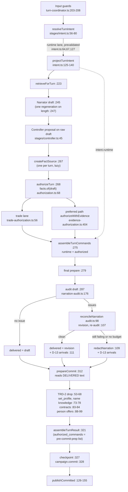

# Next pipeline and authority review (PIPE-6, PIPE-7, ARCH-2 residuals)

Status: PLANNING REVIEW, read-only. Static reading of main `7e5e4ea` (plus the uncommitted docs-only audit reconciliation). Nothing was built, run or changed. Every behavior claim below cites the current code; a claim that only execution could prove is marked **inferred** or **not confirmed by execution**. Register: [Master Technical Debt Register](../MASTER_DEBT_REGISTER.md) (rows PIPE-6, PIPE-7, ARCH-2, AUD-1, AUD-2). Related: [Turn Coordinator](../architecture/TURN_COORDINATOR.md), [Narrative authority](../architecture/NARRATIVE_AUTHORITY.md), [NarrationFacts](../architecture/NARRATION_FACTS.md), [A8 invariants](post_cleanup_audit/A8_INVARIANTS.md), [A9 register reconciliation](post_cleanup_audit/A9_REGISTER_RECONCILIATION.md).

Nothing in this document is to be implemented without the user's approval.

## 1. Summary

- The final pipeline is not `Narrator → NarrationFacts → policy → authorization → preparation → audit → commit preparation → commit`. The code proves this order: **player intent and projection (its own prevalidated lane) → retrieval → Narrator draft → Controller proposal on the raw draft → NarrationFacts, policy and authorization in one function → command assembly → final preparation → audit of the draft → (one revision and re-audit, or redaction) → commit preparation on the delivered text (adds and drops commands, re-prepares up to four times) → result assembly → checkpoint → one commit → publication.** NarrationFacts are extracted lazily inside authorization, after the Controller has already read the raw draft (section 2).
- **PIPE-6 is confirmed open, and it is wider than "a fourth lane".** Besides the preferred path (`authorizeWithEvidence`), seven in-turn producers put commands into the committed batch: the player runtime lane, the trade lane, and four commit-preparation producers (late naming, canonical-name discovery, NPC+ contracts, person offers). None of the commit-preparation commands appears in `state_proposed`, in `TurnResult.authorization` or in the trace's `committed_command_kinds`. Out-of-turn explicit actions are separate lanes by design (section 4).
- **PIPE-7 is confirmed open and is confined to the reconciliation path.** When the draft is delivered unchanged, every authorized command was verified against that same text. When the draft has any audit issue, the revision is told the outcome of only four command kinds, and nothing checks that the delivered revision or redaction still shows any authorized command, except a refused transfer, a travelling companion narrated as staying behind, and a follower's arrival (D-13). Eight command kinds, including item pickup, item creation, household join and leave and offer withdrawal, can commit while the delivered text no longer shows them. Reachable by static reading; frequency not measured (section 5).
- **New concrete case:** `withdraw_trade_offer` is authorized from a draft quote and is never re-checked against the delivered text. The TRD-2 re-check covers `propose_trade_offer` only (`commit-preparation.ts:54`).
- **New observability defect:** `TurnResult.authorized_commands` and the trace's `committed_command_kinds` come from the batch before commit preparation (`turn-coordinator.ts:321`, `result.ts:30`, `turn-trace.ts:71`). They list goods offers that TRD-2 dropped and omit every commit-preparation command.
- **AUD-2 is confirmed and slightly larger.** `establishNames` and `establishedCanonicalDisclosure` get no shared facts (`commit-preparation.ts:73-75`). `contractCommands` (`character-contracts.ts:35`) and the household-choice and relationship evidence (`household-evidence.ts:27,87`) also re-read dialogue outside the shared source. The register calls the result "the same today"; that is **inferred**: the shared source has a different scope (projected context plus movers) from the fallback readers (prepared context, no movers), so a parity test is needed before switching.
- **Recommended shape:** two blocks plus one deferred item. Block P-A declares and records the authority lanes (no behavior change except the AUD-2 parity switch). Block P-B adds a delivered-text coverage check (shadow first, then enforcement after a user decision per action class). The F evidence readers stay deferred until the transfers product block (section 11).

## 2. The final pipeline as the code behaves

### 2.1 Ordered call list

All lines are in `src/turn/coordinator/turn-coordinator.ts` unless another file is named.

| # | Step | Call (file:line) | Reads | Can add commands | Can change state |
| --- | --- | --- | --- | --- | --- |
| 1 | Input guards | `:203-208` (`turn_in_progress`, `invalid_input`, `expected_revision`), `checkpoint` `:197-200` | input | no | no |
| 2 | Base snapshot | `campaign.exportSnapshot()` `:209` | state | no | no |
| 3 | Intent resolution | `resolveTurnIntent` `:216` → `stages/intent.ts:56-80`: `buildTurnContext` `:57`, `participants.plan` `:59`, `playerIntent` `:60`, `resolvePlayerCarry` `:63` + `prevalidates` (prepare) `:64`, `resolveHeldEscort` `:66` + prepare `:67`, `resolveManumission` `:72` + `proposalCreatable` (prepare) `:73,82-85`, `extractRuleDeclarations` `:76` | player input | runtime lane (`intent.runtime`) | no (prepare is validation only) |
| 4 | Projection | `projectTurnIntent` `:218` → `intent.ts:125-140`: `prepare(runtime)` `:127` is the projected snapshot | runtime lane | no | no |
| 5 | Retrieval | `retrieveForTurn` `:223` | input, context | no | no |
| 6 | Prompt | `composeTurnPrompt` `:226` → `narration.ts:27-30`; `prepareNarratorRequest` `:227` | context, recent | no | no |
| 7 | Narrator draft | `generate(primary)` `:245` → `narration.ts:53-78`; one regeneration on `length` `:247` → `regenerateTruncated` `:111-124` | prompt | no | no |
| 8 | Controller proposal | `requestControllerProposal` `:257-258` → `stages/controller.ts:28-49`; reads the **raw draft** as `final_narration` (`controller.ts:45`) | draft | proposal only | no |
| 9 | NarrationFacts source | `createFactSource(movementFactScope(projected, ...))` `:267` (the only one per turn; scope from the projected snapshot, `movement-scope.ts:15-37`) | none yet (memoized, lazy) | no | no |
| 10 | Facts, policy, authorization | `authorizeTurn` `:268-269` → `stages/authorization.ts:44-145`: strict parse `:50`; dedupe `:56-66`; **`facts.of(draft)`** `:68`; movement policy `characterMovementsFromFacts` `:69`; stair and door closure `:74-85`; `deriveTurnEvidence` `:86` (`turn-evidence.ts:70`); derived `move_character` `:92-93`; departures and derived `leave_scene` `:97-111`; derived `place_item` from item intent `:114-116`; trade lane `authorizeTradeProposals` `:123` (`commerce/trade-authorization.ts:56`); preferred path `authorizeWithEvidence` `:124` (`evidence-authorization.ts:404` → `authorizeCommands` `command-authorizer.ts:23` → `verifyEvidence` `evidence-authorization.ts:72`); `vetoSettlementThroughItems` `:126`; `enforceItemTriangle`, `rejectConflictingItemMutations`, owner strip `:129-130` | draft facts, proposal, intent | derived proposals (decided on the same path) | no |
| 11 | Frozen diagnostics | `state_proposed` `:273` | | no | no |
| 12 | Command assembly | `assembleTurnCommands` `:275` → `authorization.ts:154-165`: `commands = [...intent.runtime, ...authorized]`; inbound gift acquisition stamp `:157-163` | | no | no |
| 13 | Final preparation | `campaign.prepare({ expected_revision: base_revision, commands })` `:279` | batch | no | no |
| 14 | Audit of the draft | `createNarrationAuditor` `:285-286` → `stages/audit.ts:59-85`; `auditor.check(draft, turn_evidence)` `:287` → `auditNarration` `narration-audit.ts:176`; `committed` is the authorized list only (`audit.ts:61,73`) | draft, `prepared.snapshot` | no | no |
| 15 | Reconciliation | when issues: `outcomeLines` `:292` → `narration-audit.ts:410-439`; `reconcileNarration` `:296-305` → `audit.ts:98-115`: `revisionRequest` `:101`; budget gate (no logical or physical generation left → no revision) `turn-coordinator.ts:300`; checkpoint `audit.ts:104`; re-audit of the revision with evidence re-derived from it `:107`; `redactNarration` `:109` (`narration-audit.ts:448-453`); D-13 arrival sentences `:111-112` | revision | no | no |
| 16 | Commit preparation | `prepareCommit` `:312-314` → `stages/commit-preparation.ts:38-107`: TRD-2 goods-offer re-check on delivered text `:53-68` (prepare `:64`); `buildTurnContext(prepared)` `:71`; `partnerNameConflict` (shared facts) `:72`; `establishNames` (**no shared facts**) `:73-74`; `establishedCanonicalDisclosure` (**no shared facts**) `:75`; `learnCanonicalName` `:76`; prepare `:78`; `contractCommands` (own dialogue reading) `:83`, prepare `:84`; `resolvePersonOffers` (shared facts) `:92`, prepare `:96`; any identity exception keeps the final preparation `:101-106` | **delivered text** | yes (section 4, L5) | no |
| 17 | Portrayal shadow | `inspectPackedPortrayal` `:317` (diagnostic only) | delivered | no | no |
| 18 | Empty-text guard | `:319` (`narrator_failed`) | | no | no |
| 19 | Result draft | `assembleTurnResult` `:321-324` → `result.ts:21-45`; `authorized_commands: i.commands` is the step 12 list | | no | no |
| 20 | Commit | `checkpoint()` `:327`; `campaign.commit(plan.receipt)` `:328` | receipt | no | **yes, the only mutation** |
| 21 | Publication | `publishCommitted` `:331` → `:126-155`: `state_committed` `:135`, `recordExchange` `:138`, participant naming `:144`, `narration_completed` `:150`, warnings `:151`, `turn_completed` `:154` | | no | no (session memory only) |
| 22 | Session | `GameSession.#runTurn` `src/app/game-session.ts:1061-1140`: trace (`turn-trace.ts:71`), pending confirmations, optional work launched detached `:1142-1175` | | no | optional side store only |

Every `prepare` is a full batch from the captured base revision. Per turn there are up to `2 + n + 1` validation preparations in the intent stage, one final preparation and up to four in commit preparation; only the last receipt is committed.

### 2.2 Call graph

### 2.3 Differences from the documented order

- `docs/ARCHITECTURE.md:57` and the coordinator header (`turn-coordinator.ts:42-44`) give the right macro order. There is no separate "NarrationFacts" or "policy" stage: facts are read inside `authorizeTurn` (`authorization.ts:68`), and the policy adapters (`movement-evidence.ts`, `trade-authorization.ts`, `household-evidence.ts`, `attributed-speech.ts`) are called from authorization, the audit and commit preparation.
- The Controller reads the raw draft, not facts (`controller.ts:45`). The facts layer cannot steer what is proposed, only what is authorized.
- The audit runs on `prepared.snapshot` from step 13. It never sees the commit-preparation additions (step 16).

## 3. Stage re-evaluation

### 3.1 Command preparation (steps 3, 4, 12, 13)

- The player runtime lane is resolved and prevalidated before any provider call (`intent.ts:64,67,93,127`). It never passes authorization. It is the player's own act (Class A, or Class B for carry and escort), so this is by design.
- Command kinds in that lane: `runtime_delta` (location with route minutes, time advance, mana: `player-intent.ts:67,71,83`), `move_character` for carry and held-person escort (`intent.ts:63-68`). Manumission is recognized only as a pending proposal (`intent.ts:69-78`).
- `assembleTurnCommands` puts runtime commands first, then authorized ones (`authorization.ts:164`), and stamps gift provenance on inbound gifts (`:157-163`). This is the only place an authorized command is changed after the decision; the change is deterministic.
- Verdict: sound. Residual: runtime commands are not in the audit's `committed` list (`audit.ts:61,73`), so the revision is not told about them (section 5, C5).

### 3.2 Evidence authorization (step 10)

- The preferred path: the grammar authorizer decides first (`command-authorizer.ts:23-156`); in `hybrid` mode a verified Controller quote completes a command the grammar rejected only for missing confirmation (`evidence-authorization.ts:404-436`); group atomicity rules follow (`:437-457`). The default mode is `hybrid` (`turn-coordinator.ts:269`).
- Derived proposals (movement recall, departures, item intent) are decided on the same path (`authorization.ts:117,124`). That is good: the engine may propose, but not authorize, on its own.
- The trade lane (`trade-authorization.ts:56-124`) is a second evidence path with its own diagnostics. It refuses Controller person offers (`:79`). Post-decision filters only reject (`authorization.ts:126,129-130`).
- F readers (ARCH-2 residual): `verifyEvidence` keeps its own verb families (`RECEIPT`, `PICKUP_ACT`, `PUTDOWN_ACT`, `COMMUNICATE`, `OUTCOME_CONTRADICTS`, `ITEM_LOST`: `evidence-authorization.ts:37-47,357-359`); `turn-evidence.ts` keeps `uncertain`, `refusal`, `notRefusal` and others (`turn-evidence.ts:35-40`). They verify the Controller's cited quotes; they do not attribute speakers. Classified F by `tests/architecture/narration-facts-consumers.architecture.test.ts` (test 5).
- Verdict: the preferred path is coherent and fail-closed. Its only structural gap is that it reads the draft once and its decisions are never revisited when the delivered text changes (PIPE-7).

### 3.3 Audit (steps 14 and 15)

- Direction covered well: prose that asserts what did not commit (`asserts_uncommitted_transfer`, `uncommitted_departure`, `uncommitted_movement`, `uncommitted_condition`, `uncommitted_household`, `asserts_uncommitted_purchase`, `uncommitted_pending_confirmation` and others; `narration-audit.ts:40-42`).
- Direction covered narrowly: prose that denies or omits what did commit. Only `contradicts_committed_transfer` (refusal of a committed transfer, `:209-212`), `contradicts_committed_movement` (a travelling escort or follower narrated as staying, `:540-552`) and the D-13 arrival sentence (`audit.ts:111-112`).
- The revision is told the outcome only for `transfer_item`, `set_condition`, `leave_scene` and `move_character` (`narration-audit.ts:419-425`). The audit has no rule for `place_item`, `create_item`, `join_household`, `leave_household`, `add_household_rule`, `adjust_relationship`, `set_knowledge`, `schedule_event` or `withdraw_trade_offer` (no match in `narration-audit.ts`).
- Redaction drops whole flagged sentences and appends outcome prose only when an issue is about an uncommitted transfer or a false premise; that prose contains only "stays with" lines (`narration-audit.ts:430-436,448-453`).
- Verdict: a sound safety net for over-claiming; not a guarantee that committed state is shown.

### 3.4 Commit preparation (step 16)

- It reads the delivered text, so whatever it adds is shown by the text the player reads. That is its strength.
- It adds commands that no authorizer decided (section 4, L5), re-prepares the batch up to four times (`commit-preparation.ts:64,78,84,96`) and drops changes observably on failure (`on_skip`, `:66,84,98,104`).
- TRD-2 is the one place where a draft-time decision is re-decided on the delivered text (`:48-68`). It covers goods and item offers only.
- Verdict: correct in intent; under-observed (section 4.3) and partly outside the shared facts (AUD-2, section 6).

## 4. PIPE-6: authority lanes

### 4.1 Every lane that puts a command into a commit

| Lane | Where | Command kinds | Decided by | In `state_proposed` / `TurnResult.authorization` | In trace `committed_command_kinds` | Bypasses `authorizeWithEvidence` |
| --- | --- | --- | --- | --- | --- | --- |
| L1 player runtime | `intent.ts:56-80,127`; `authorization.ts:164` | `runtime_delta`, `move_character` (carry, escort) | deterministic intent + prevalidation | no | yes | yes, by design (player-authored) |
| L2 preferred path | `authorization.ts:124` | ordinary Controller kinds and derived proposals | grammar + verified quote | yes | yes | no |
| L3 trade | `authorization.ts:123`; `trade-authorization.ts:56` | `propose_trade_offer` (goods, items), `withdraw_trade_offer` | trade evidence path | yes | yes | yes, by design (own evidence path) |
| L4 post-decision filters | `authorization.ts:126,129-130,157-163` | none added; rejections and provenance stamp | deterministic | yes | yes | inside the stage |
| L5a late naming | `name-establishment.ts:49-58` via `commit-preparation.ts:73` | `set_profile` (name of an existing unnamed persistent character) | scene reading of delivered text | no | no | **yes** |
| L5b canonical-name discovery | `commit-preparation.ts:75-76`; `identity-knowledge.ts:11-20` | `create_fact`, `set_knowledge` for Nicco | disclosure gate on delivered text | no | no | **yes**; the preferred path forbids `set_knowledge` for Nicco (`command-authorizer.ts:130`) |
| L5c NPC+ contracts | `character-contracts.ts:30-51` via `commit-preparation.ts:83-84` | `establish_character_contract` (set-once) | quoted first-person line of an active NPC+ | no | no | **yes**; not in the Controller schema |
| L5d person offers | `person-offers.ts` via `commit-preparation.ts:88-99` | `propose_trade_offer` with a person subject (stored settlement plan) | scene reading of delivered text | only as `person_transactions` diagnostics (`result.ts:41`) | no | **yes**; the trade lane refuses this kind from the Controller (`trade-authorization.ts:79`) |
| L5e TRD-2 drop | `commit-preparation.ts:53-68` | removes goods offers | trade path on delivered text | `person_transactions` reason `quote_not_in_delivered_text` | still listed (defect) | drop only |
| L6 explicit player actions | `game-session.ts:404-418` (Heartstone rite), `:473-487` (confirm pending), `:560-573` (Accept), `:599-614` (Keep track), `:628-646` and `:661-673` (appearance, profile), portrait commits `:802,851,917,935` | settlement, join plus NPC+, manumission, retire or merge, `register_character`, `set_profile`, media | opaque ref + `expected_revision` | not turn lanes | not turn lanes | yes, by design (Class C or editor) |
| L7 operator | `game-session.ts:373-390` (location correction), `:514` (repair request creates a pending record only) | `runtime_delta` | explicit request | n/a | n/a | yes, by design |
| L8 optional enrichment | `game-session.ts:1142-1175` | learning side store only (Block 7) | optional services | n/a | n/a | not authoritative (Reflection notes are soft-promoted enrichment by user decision) |
| Implicit producer | `campaign/preparation.ts:11-20` (`characterForUpdate`, AUTH-5) | creates a canonical-origin record when any lane targets an unrecorded canonical NPC | CampaignState | invisible | invisible | side effect of any lane (ID-8 / D5) |

The lanes that bypass the preferred path **without** being an explicit player action are L1, L3 and L5a to L5d. L1 and L3 are deliberate and visible. **L5a to L5d are the PIPE-6 lanes**: they decide on narration, they are not visible as decisions, and the audit never sees their effect.

### 4.2 Risk per PIPE-6 lane

| Lane | Failure mode | Reversible | Currently reachable | Proposed severity |
| --- | --- | --- | --- | --- |
| L5a `set_profile` name | a misattributed self-introduction names the wrong unnamed record; reserved canonical handles are refused (`name-establishment.ts:54`) | no rename path in play (NAME-1 is a key name, not a rename feature) | reachable on every turn with a self-introduction; no wrong case known | P3 |
| L5b name knowledge | Nicco "knows" a canonical name the player did not see given; gated by the disclosure capability (`canonical-name-disclosure.ts:128-160`) | no | reachable; no wrong case known | P3 |
| L5c contracts | a set-once contract from a misattributed quoted line; set-once means permanent (`character-contracts.ts:16-17,45`) | no | reachable with an active NPC+ present; no wrong case known | P3 (permanent on a false positive) |
| L5d person offers | the stored plan materializes a person on Accept without the reserved-handle rule (AUD-1; no `claimsReservedHandle` in `person-offers.ts`, confirmed by search) | Accept is explicit and guarded | reachable; AUD-1 unconfirmed by execution | P2 (through AUD-1) |
| all L5 | invisible in `state_proposed`, `TurnResult.authorization` and `committed_command_kinds`; audit runs before them | | always | P3 (observability) |

PIPE-6 overall: keep **P2** as a structural item. No incorrect commit was found; the issue is that four producers with irreversible effects are undeclared, unobserved and outside the audit.

### 4.3 Observability defect found

`assembleTurnResult` receives `commands` from step 12 (`turn-coordinator.ts:321`) and publishes them as `authorized_commands` (`result.ts:30`). The trace copies them as `committed_command_kinds` (`turn-trace.ts:71`); the observer does the same at `turn-coordinator.ts:280`. So the trace:

- lists a goods offer that TRD-2 dropped and that never committed;
- omits every L5 command that did commit.

Diagnostics only; no state is affected. P3.

## 5. PIPE-7: structured action committed while the delivered prose does not show it

### 5.1 Where the divergence can arise

Authorization reads the draft (`authorization.ts:68,86,124`). The delivered text is the draft, a revision or a redaction (`audit.ts:105-114`). Only TRD-2 re-decides on the delivered text, and only for goods offers (`commit-preparation.ts:54`). Therefore:

| Case | Path | Mechanism | Detection or repair today | Status |
| --- | --- | --- | --- | --- |
| C0 clean draft | delivered = draft | every authorized command was verified on this text | not needed | no divergence |
| C1 revision omits an untold kind | draft has any audit issue (any of the 23 kinds, often unrelated, such as an invented price) | the revision prompt lists no COMMITTED line for `place_item`, `create_item`, `join_household`, `leave_household`, `add_household_rule`, `adjust_relationship`, `set_knowledge`, `schedule_event`, `withdraw_trade_offer` (`narration-audit.ts:419-425`) | none | **reachable** (static reading) |
| C2 revision omits a told kind | same | COMMITTED lines exist for transfer, condition, `leave_scene`, `move_character` | refusal of a transfer (`:209-212`, re-derived on the revision `audit.ts:107`); companion stay-behind on travel (`:540-552`); D-13 arrival of a follower at Nicco's place (`audit.ts:111-112`). Plain omission is not detected | **reachable**, mitigated |
| C3 redaction drops the evidence sentence | revision still fails, or no revision can run (the second logical generation was used by truncation recovery, or the revision ended with `length`: `turn-coordinator.ts:300`, `audit.ts:105`) | a flagged sentence is removed whole (`narration-audit.ts:449-450`); a compound sentence can carry both an authorized act and an uncommitted claim, for example a committed handover and an uncommitted exit in one sentence | appended prose covers only uncommitted transfers (`:451`) and D-13 arrivals | **reachable** (static reading; no test found that builds this case) |
| C4 offer withdrawal | C1 or C3 with an authorized `withdraw_trade_offer` | not re-checked on the delivered text (`commit-preparation.ts:54` filters `propose_trade_offer` only) | none | **reachable** |
| C5 player runtime lane | any path | runtime commands are not in the audit's `committed` list (`audit.ts:61,73`), so the revision is not told; the Narrator wrote from the projected state | escort stay-behind via `before` (`narration-audit.ts:542-543`); exact elapsed time (`:97-140`) | theoretical to low (the Narrator would have to contradict the projected prompt) |
| C6 commit-preparation lanes | any path | they read the delivered text | consistent by construction | no divergence |

Inverse direction, recorded only: a revision can also narrate a new pickup or creation that never committed; the audit has no `place_item` or `create_item` rule. That is "prose without state", already the audit's general domain, and out of scope here.

How often C1 to C4 happen is not known. The trace records `delivered` (`draft`, `revision`, `redacted`) and issue kinds per turn (`turn-coordinator.ts:288-289,309-310`), so the rate can be measured from existing traces before any change.

### 5.2 Existing protection

- `tests/movement/follow-revision-reconciliation.test.ts:25,44`: the revision is told about a committed follow; the authorized follow survives redaction.
- `tests/turn/turn-stages.test.ts:51,62`: revision and redaction mechanics.
- `tests/commerce/trade-offer-authorization.test.ts:88`: TRD-2 drops a goods offer whose quote is gone.
- `tests/authority/valid-narration-survives-audit.test.ts`: valid narration is not over-flagged.
- A search of `tests/` found no test for C1 with the untold kinds, C3 with a compound sentence, or C4.

## 6. ARCH-2 residuals and AUD-2

| Residual | Location | Verdict | Recommendation |
| --- | --- | --- | --- |
| AUD-2 name establishment | `commit-preparation.ts:73-74` calls `establishNames` without `facts`; fallback `readScene` at `name-establishment.ts:42` and a second `createFactSource({ movers: [] ... })` at `:45` (A8 cites `:40` and `:43`; the lines moved) | CONFIRMED | pass `facts: i.facts`, after a parity test |
| AUD-2 canonical disclosure | `commit-preparation.ts:75`; `canonical-name-disclosure.ts:128-160` has no `facts` parameter and calls `identityForms` and `rpgDialogue` directly | CONFIRMED | accept the shared source's identity facts for the delivered text |
| AUD-2 extension: contracts | `character-contracts.ts:35` calls `dialogueUnits(narration, 0, presentPeople(context))` itself | NEW, same class | read `facts.of(delivered).dialogue` |
| AUD-2 extension: household and relationship evidence | `household-evidence.ts:27,87` call `attributedSpeech(narration, context)` without `units`; the audit passes them (`narration-audit.ts:217,628`) | NEW, same class | pass the shared dialogue units |
| F evidence readers | `evidence-authorization.ts:37-47,357-359`; `turn-evidence.ts:35-40` | CONFIRMED OPEN, deferred by design | move the item-act verb families into NarrationFacts with the transfers product block (section 9) |
| D domain readers | household JOIN and LEAVE wording, grounding, item ownership, pending audit, mannerism | by design | none |
| B player-input readers | intent stage | by design | none |

"Same result today" (register AUD-2) is **inferred, not proven**. The shared source's scope comes from the projected snapshot and includes movers and NPC+ entrants (`movement-scope.ts:15-37`, `extract.ts:39-43`); the fallback readers use the prepared context and no movers. They can differ when an authorized movement or departure changes who is present, or when an arriving mover is a candidate speaker. Switching without a parity test could change identity results.

Architecture test 4 checks that `name-establishment.ts` can use `options.facts.scene(` (`narration-facts-consumers.architecture.test.ts`), not that commit preparation passes it; test 1 checks only that `prepareCommit` receives `facts: factSource`.

## 7. Affected action classes and severity

Authority classes as in `docs/ARCHITECTURE.md` §2c. "Reachable" means reachable by static reading; none was confirmed by execution.

| Action class (command kind) | Authority class | Lane | PIPE-6 | PIPE-7 case | Reachable or theoretical | Impact of a divergence | Proposed severity |
| --- | --- | --- | --- | --- | --- | --- | --- |
| Item pickup or put-down (`place_item`, location placement) | B | L2 | no | C1, C3 | reachable | inventory changes silently; the user's first roadmap area (ownership, possession, localization) | **P2** |
| Item creation (`create_item`) | B | L2 | no | C1, C3 | reachable | a new tracked item the player never read about | **P2** |
| Transfer between people (`transfer_item`) | B | L2 | no | C2, C3 | reachable, mitigated | possession and possibly ownership (gift) change unseen | **P2** (C3), P3 (C2) |
| Household departure (`leave_household`) | B (voiced choice) | L2 | no | C1, C3 | reachable, rare (needs an authorized voiced choice plus an audit issue) | an NPC+ member leaves unseen; touches D4 | **P2** |
| Household join (`join_household`, not into Nicco's household: `command-authorizer.ts:98`) | B | L2 | no | C1, C3 | theoretical to rare | membership elsewhere changes unseen | P3 |
| Offer withdrawal (`withdraw_trade_offer`) | B | L3 | no | C4 | reachable | the standing offer card disappears; the player cannot Accept | **P2** |
| NPC movement (`move_character`) | B | L2 | no | C2, C3 | reachable, mitigated for arrivals only | a person is elsewhere next turn | P3 |
| Departure (`leave_scene`) | B | L2 | no | C2, C3 | reachable, mitigated | a person vanishes from the scene | P3 |
| Physical condition (`set_condition`) | B | L2 | no | C2, C3 | reachable, mitigated | an injury the text no longer shows | P3 |
| Relationship step (`adjust_relationship`) | B | L2 | no | C1, C3 | reachable | hidden attitude change | P3 |
| Knowledge told (`set_knowledge`, player `/tell`) | B | L2 | no | C1, C3 | reachable | an NPC knows a fact the text no longer shows | P3 |
| Scheduled event (`schedule_event`) | B | L2 | no | C1 | theoretical (needs exact time evidence) | an appointment the text no longer shows | P3 |
| Household rule (`add_household_rule`) | B (player declaration) | L2 | no | C1 | theoretical (the player wrote the rule) | low | P3 |
| Goods or item offer (`propose_trade_offer`) | C at Accept | L3 | no | none (TRD-2) | n/a | | closed (trace defect P3) |
| Player travel, time, mana, carry, escort (`runtime_delta`, `move_character`) | A / B | L1 | lane by design | C5 | theoretical to low | location or time the text contradicts | P3 |
| Late naming (`set_profile`) | B | L5a | **yes** | none | reachable lane | wrong name on a record, hard to undo | P3 |
| Canonical-name knowledge (`create_fact`, `set_knowledge` Nicco) | B | L5b | **yes** | none | reachable lane | irreversible knowledge | P3 |
| NPC+ contract (`establish_character_contract`) | B | L5c | **yes** | none | reachable lane | permanent personality field | P3 |
| Person offer (`propose_trade_offer`, person) | C at Accept | L5d | **yes** | none | reachable lane | Accept materializes; AUD-1 | **P2** |

## 8. Safest architectural fix

### 8.1 Principles

- Keep one commit, one fact source, no new provider call, no new revision round. The Narrator ledger limits (2 logical, 3 physical) stay as they are.
- Do not route commit-preparation producers through `authorizeWithEvidence`. They are not Controller proposals, have no Controller quote and would all be rejected there; forcing them through would change semantics, not consolidate them.
- Generalize the two precedents the code already has: **TRD-2** (re-decide on the delivered text, drop what is no longer shown, re-prepare) and **D-13** (append a deterministic sentence for committed state the text omits).
- Measure first. Every enforcing step starts as a diagnostic.

### 8.2 PIPE-6: declare and record the lanes

1. **Lane records.** Each commit-preparation producer returns a typed record `{ lane, command, evidence_sentence, authority_class }`. `CommitPlan` carries them (`commit-preparation.ts:29-37`), `TurnResult` publishes them in a new field next to `authorization` (keep `AuthorizationDiagnostic` for the authorization stage only), and the trace adds them.
2. **Accurate committed list.** `TurnResult.authorized_commands` stays "authorized", and a new `committed_commands` (or the trace's `committed_command_kinds`) is taken from the command list the final receipt was prepared from (`applied` plus offers, `commit-preparation.ts:80,96`).
3. **Closed lane vocabulary.** An architecture test pins which kinds each lane may emit: L5a only `set_profile` with a name change on an existing unnamed record; L5b only `create_fact` plus `set_knowledge` for Nicco on an identity-name fact; L5c only `establish_character_contract`; L5d only person `propose_trade_offer`. It also pins that the Controller schema and the trade lane never emit L5 kinds (already true: `trade-authorization.ts:79`, `command-authorizer.ts:130,132`).
4. **AUD-2.** Pass the shared source to `establishNames`, `establishedCanonicalDisclosure`, `contractCommands` and the household-evidence speech reading, behind a parity test (section 6).
5. **Optional, measure first:** a final batch check that re-runs only the state-dependent audit rules that commit preparation can change (the TRD-10 standing-offer rule, `narration-audit.ts:697-707`) against the final receipt. Reordering the audit after commit preparation is not possible: commit preparation reads the delivered text the audit produces.

### 8.3 PIPE-7: delivered-text coverage

1. **Preventive (cheap).** `outcomeLines` adds a COMMITTED line for every authorized kind (`narration-audit.ts:419-425`), and for runtime commands, so the revision is told the whole outcome.
2. **Coverage check.** At the start of commit preparation, when `delivery.delivered !== "draft"`, each authorized narration-derived command is checked for being shown in the delivered text, with the same evidence functions authorization used, read on the delivered text: movement and departures from `facts.of(delivered)` (the shared source memoizes it); item, transfer, household, relationship and knowledge acts through `verifyEvidence` over the delivered sentence spans, which is exactly how the audit already searches for uncommitted transfers (`narration-audit.ts:203-205`); trade through `authorizeTradeProposals`, which absorbs TRD-2 and adds `withdraw_trade_offer` (C4). Runtime commands and the player's own rule declarations are excluded.
3. **Outcome per class (user decision required).** Two options, per class:
   - **state follows the delivered text:** drop the command and re-prepare, as TRD-2 does. Safe direction for social or voluntary acts, where a template sentence would put a choice or a feeling into a character's mouth.
   - **text follows state:** append one deterministic sentence, as D-13 does. Suits physical, visible acts the draft showed completed.

   Proposed default for the decision:

   | Kinds | Proposed outcome |
   | --- | --- |
   | `place_item`, `create_item`, `transfer_item` (handoff), `move_character`, `leave_scene` | append a deterministic sentence (generalized D-13) |
   | `transfer_item` (gift), `join_household`, `leave_household`, `adjust_relationship`, `set_knowledge`, `schedule_event`, `withdraw_trade_offer`, `set_condition` | drop and re-prepare (generalized TRD-2) |

   If dropping one command makes the batch fail validation, fall back to the append path for that command; never fail the turn.
4. **Shadow first.** Step 2 runs as a diagnostic only (a new trace field such as `uncovered_commands`) until the live rate is known. Enforcement follows the decision in step 3.

## 9. Migration strategy

| Step | Content | Behavior change | Gate |
| --- | --- | --- | --- |
| 0 | Measure: count `delivered` = `revision` / `redacted` and issue kinds in existing local traces | none | none |
| 1 | PIPE-6 lane records, accurate committed list in result and trace, lane vocabulary architecture test | diagnostics only | full suite and benchmark unchanged |
| 2 | AUD-2: parity test over the identity, commerce and benchmark fixtures with and without the shared source; then pass the source | none expected; any difference is a finding to resolve first | parity test green |
| 3 | PIPE-7 preventive COMMITTED lines for every kind | revision prompt text only | revision prompt snapshot tests updated deliberately |
| 4 | PIPE-7 coverage in shadow mode (trace field) | diagnostics only | measured rate from local play or a bounded live run (user approval for any paid run) |
| 5 | User decision on the per-class outcome table (8.3 step 3) | none | decision recorded in the register section 16 |
| 6 | Enforcement: `withdraw_trade_offer` re-check first (smallest, same mechanism as TRD-2), then the approved per-class outcomes | delivered text or committed batch on reconciled turns only | regression suite below |
| 7 | Deferred: F readers move into NarrationFacts as item-act facts with the robust-transfers product block, because coverage reuses `verifyEvidence` and the transfers block will touch the same verb families | authorization inputs | benchmark plus the possession receipt corpus |

Each step is reversible on its own. Steps 1 to 4 change no committed state.

## 10. Regression suite required

### 10.1 Existing suites that must stay green

`npm test` (3701 at the last recorded run) and `npm run benchmark:modern` (55/55), in particular:

- `tests/turn/turn-pipeline-invariants.test.ts` (one commit, cancellation, stale revision), `tests/turn/turn-stages.test.ts`, `tests/turn/turn-pipeline-golden.test.ts` (event order), `tests/turn/narrator-length-recovery.test.ts` (ledger), `tests/turn/post-commit-guards.test.ts`;
- `tests/architecture/narration-facts-consumers.architecture.test.ts`;
- `tests/movement/follow-revision-reconciliation.test.ts`, `tests/movement/canonical-departure.test.ts`, `tests/movement/live-movement.regression.test.ts`;
- `tests/commerce/trade-offer-authorization.test.ts`, `tests/commerce/actual-offer.test.ts`, `tests/commerce/person-offer-playthrough.regression.test.ts`;
- `tests/identity/name-knowledge-commit.test.ts`, `tests/identity/canonical-name-reservation.regression.test.ts`, `tests/identity/partner-identity-subject.regression.test.ts`, `tests/identity/self-name-disclosure.test.ts`, `tests/identity/canonical-identity-gating.test.ts`;
- `tests/authority/valid-narration-survives-audit.test.ts`, `tests/authority/possession-receipt-corpus.test.ts`, `tests/authority/live-npc-handover.regression.test.ts`.

### 10.2 New tests

| Test | Block | Asserts |
| --- | --- | --- |
| Lane vocabulary (architecture) | P-A | each L5 producer emits only its kinds; the Controller schema and trade lane never emit L5 kinds; every `campaign.commit` call site is a declared lane |
| Committed list accuracy | P-A | a turn whose goods offer TRD-2 drops does not list it; a turn with a late naming lists `set_profile` |
| Shared facts in commit preparation (architecture) | P-A | `prepareCommit` passes the source to `establishNames`, disclosure and contracts; no fallback `createFactSource` is reached inside a turn |
| AUD-2 parity | P-A | identical identity resolution, disclosure and contracts with and without the shared source over the identity and benchmark fixtures, including a turn with an authorized arrival |
| C1 per kind | P-B | draft with an unrelated issue plus an authorized `place_item` (then `create_item`, `leave_household`, `adjust_relationship`, `set_knowledge`); revision omits it; expected outcome per the decision |
| C3 compound redaction | P-B | one sentence holds a committed handover and an uncommitted exit; the revision fails; the delivered text shows the handover or the handover is dropped, per the decision |
| C3 after truncation recovery | P-B | primary truncated, recovery used the second logical generation, audit issue, no revision: the coverage outcome applies to the redacted draft; no third logical generation is requested |
| C4 withdrawal | P-B | an authorized withdrawal whose quote is gone from the revision does not commit (or is stated, per the decision) |
| Clean draft unchanged | P-B | `delivered = draft` turns produce identical receipts before and after the change |
| Invariants | P-B | still one commit, no extra provider request, stale and cancel behavior unchanged, a coverage drop that fails validation never fails the turn |
| Benchmark scenarios | P-B | at least one scripted reconciliation scenario per enforced class added to `tests/benchmark/scenarios.ts` |

## 11. One block or multiple

**Multiple: two blocks, plus one deferred item.**

| Block | Content | Size | Behavior change | Needs a decision |
| --- | --- | --- | --- | --- |
| P-A Authority lanes declared and observed | PIPE-6 steps 1 to 4 of 8.2, AUD-2 with parity, committed-list fix, the documentation corrections in section 12 | S to M | none expected (parity-guarded) | no |
| P-B Delivered-text coverage | PIPE-7 steps 1 to 4 of 8.3, shadow, then enforcement starting with the withdrawal re-check | M | yes, on reconciled turns only | yes: the per-class outcome table |
| Deferred | F evidence readers into NarrationFacts | M | yes (authorization inputs) | no; schedule with the robust-transfers product block |

Reasons not to make one block: P-A is a non-behavioral refactor that makes P-B measurable (lane records and an accurate committed list); P-B changes delivered text or committed state and depends on a measured rate and a user decision. Mixing them would make any regression hard to attribute. P-A first, then P-B.

## 12. Documentation drift found

- `docs/architecture/TURN_COORDINATOR.md` (section "Live NPC Regression Repair 1", around lines 196-211) still shows `narration_delta` before the commit and says "Narration is released after preparation and before commit". The code emits no `narration_delta` at all (`turn-types.ts:62-72`); `state_committed` precedes `narration_completed` (`turn-coordinator.ts:135,150`). The section's invariant states only one direction (no unauthorized assertion); PIPE-7 is the missing other direction.
- `docs/architecture/TURN_COORDINATOR.md:77` says the Controller exposes only four command kinds; the schema has many more (`src/llm/controller-schema.ts:22-45`). Labelled historical, but uncaveated on that line.
- `docs/architecture/NARRATIVE_AUTHORITY.md:22` says durable changes happen only through Controller proposal and authorization. Lanes L1, L5a to L5d and L6 contradict it.
- `docs/evaluations/post_cleanup_audit/A8_INVARIANTS.md` cites `name-establishment.ts:40` and `:43`; the current lines are `:42` and `:45`.

## 13. Evidence limits

- Static reading only. No test, build or provider call was run. "Reachable" means a code path exists that leads there; no case in sections 5 and 7 was reproduced.
- The frequency of reconciled turns, and so the practical weight of PIPE-7, is unknown.
- AUD-1 (the person offer plan without the reserved-handle rule) is confirmed only by the absence of `claimsReservedHandle` in `person-offers.ts`; its behavior on Accept was not traced end to end here.
- The AUD-2 equivalence claim is inferred (section 6).
