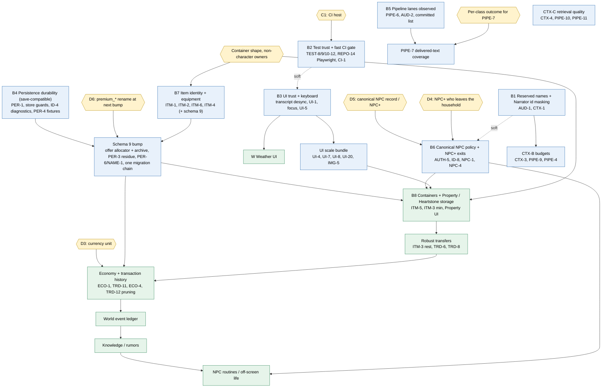

# Post-cleanup debt dependency graph

Date: 2026-10-13, main `ed7e85f`. Planning only. This graph links the remaining meaningful work: the open debt in the [Master Technical Debt Register](../MASTER_DEBT_REGISTER.md), the new findings in the [product work plan](POST_CLEANUP_PRODUCT_WORK_PLAN.md), and the product steps on the user's roadmap. An edge means that the code or a decision actually requires the earlier node first. Where a link is only a preference or a cost saving, the table says "soft". Block numbers B1 to B8 and the W track refer to the [Next implementation program](NEXT_IMPLEMENTATION_PROGRAM.md).

## Graph

The product chain at the bottom is the user's established roadmap: ownership, possession and item localization (B7 and B8), then robust transfers, then economy and transaction history, then the world event ledger, then knowledge and rumors, then NPC routines.

## Table

| Block | Depends on | Unblocks | Risk | Human decision? |
| --- | --- | --- | --- | --- |
| B1 Reserved names and Narrator id masking (AUD-1, CTX-1, leaked-ref diagnostic) | nothing | CTX-A2 output guard, CTX-B; makes B6 cleaner (soft) | Low. The reserved-name rule exists (`src/turn/identity/canonical-name-reservation.ts`); the mask fix is one pattern. AUD-1 is unconfirmed by execution, so the block starts with a failing test. | No (REPO-12 already decided the rule). AUD-1a vs 1b is a small UX choice with a recommended default. |
| B2 Test trust and fast CI gate (TEST-8, TEST-9, TEST-10 to TEST-12, REPO-14 Playwright, FAST PR) | C1 for the workflow file only | every later block (cheaper certification); FULL PR browser gate | Low. Test and tooling only; no product code. | Yes for the CI host (C1) and platform claims (C2). The test-trust part needs none. |
| B3 UI trust and keyboard (transcript desync, UI-1, focus, live regions, UI-5 copy, mojibake) | nothing (soft: B2 for a keyboard browser check that can fail) | Weather UI, UI scale bundle | Low to medium: `client.js` is one large file; behavior is pinned by `tests/ui/play-client.test.ts`. | No. The person-purchase confirm step (UI-2, Q1) stays out unless decided. |
| B4 Persistence durability, save-compatible (P0 to P5 of the persistence review) | nothing | the schema 9 bump | Medium: touches the save path; must stay readable by older and newer builds. | C6 (copying evidence saves into `tests/fixtures/`) for the fixture part. |
| B5 Pipeline lanes declared and observed (PIPE-6, AUD-2 with parity, committed list, doc corrections) | nothing | PIPE-7 coverage | Medium: the coordinator is central; the block is meant to be behavior-neutral and is guarded by the benchmark and a parity test. | No. |
| B6 Canonical NPC policy and NPC+ exits (AUTH-5 / ID-8 Option A, NPC-1, NPC-4, demotion) | D5, D4 | Property (canonical visitors), NPC routines | Medium: small code, but it fixes product rules that are hard to reverse in players' saves. | **Yes**: D5, D4, and whether NPC+ can ever be demoted. |
| B7 Item identity and equipment (ITM-1, ITM-2, ITM-6, ITM-4 with quantity) | container-shape and owner-kind decisions; plan the bump with D6 and the persistence schema-9 items | the schema 9 bump, Property | High: schema change, item identity is used by authorization, offers and the UI. | **Yes**: ITM-2 meaning of `empty_slots`, container shape, owner kinds, whether the bump carries D6. |
| Schema 9 bump (offer ID allocator and archive, PER-3 residue, PER-6 / NAME-1, one migration chain, the bump rule) | B4, B7 (if item fields ride along), D6; D3 for the ledger shape | Property, offer pruning, economy ledgers | High: one migration for all saves. | Yes (D6; D3 for the archive shape) |
| B8 Containers and Property / Heartstone storage | B6, B7, schema 9, the UI scale bundle, container decisions | robust transfers | High: new product system. | **Yes**: structured property ownership vs the deed item; D5 for canonical visitors. |
| W Weather UI | B3 (soft: the header and live region work) | nothing | Low: presentation over `SessionView.scene.environment`; no engine change. | Light: header or location card, no forecast (recommended defaults exist, Q3). |
| UI scale bundle (UI-4, UI-7, UI-8, UI-20, IMG-5, a seeded scale fixture) | B3 | B8 | Medium | No |
| PIPE-7 delivered-text coverage | B5 | safer reconciled turns | Medium: changes delivered text or committed state on reconciled turns. | **Yes**: per action class, drop the command or append a deterministic sentence. |
| CTX-B budgets (Controller view by allow-list, single encoding, token cap, Narrator retrieval and revision reserves) | B1 (soft) | fewer `context_too_large` failures | Medium | Yes for one point: may the Controller see narrator-only canon? |
| CTX-C retrieval quality (CTX-4, PIPE-10, PIPE-11) | nothing | better follow-up narration | Low to medium | No |
| Economy and transaction history (ECO-1, TRD-11 with the SELL buyer debit, ECO-4, TRD-12 pruning, then ECO-2, TRD-7, TRD-14) | D3, schema 9 (or its own bump), robust transfers | world event ledger, receipts UI | High: currency unit change. | **Yes**: D3 |
| World event ledger, knowledge / rumors, NPC routines | economy ledger shape (reuse), B6 for routines | off-screen simulation | High: new systems | Yes, each |

## Dependencies the code does not require

These are often assumed but are not hard requirements in the current code:

- **Weather UI does not depend on Property, persistence or items.** The data already reaches `SessionView.scene.environment`; only the server forward (`src/ui/server.ts:46`) and the client view are missing.
- **Economy work does not have to precede Property**, unless the first Property slice includes buying, renting or selling property, or merchant stock held in containers ([items and economy review](NEXT_ITEMS_ECONOMY_REVIEW.md) section 7).
- **AUD-1 does not wait for D5.** It completes the REPO-12 reserved-name decision, which already covers persons materialized through an offer.
- **CTX-C does not depend on CTX-A or CTX-B**; it is retrieval logic in `src/retrieval/` and the context builder.
- **B5 (lanes observed) does not need a decision**; only PIPE-7 enforcement does.
